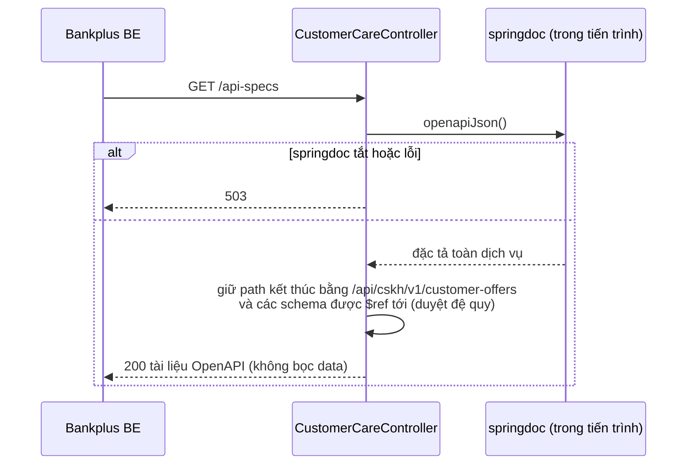
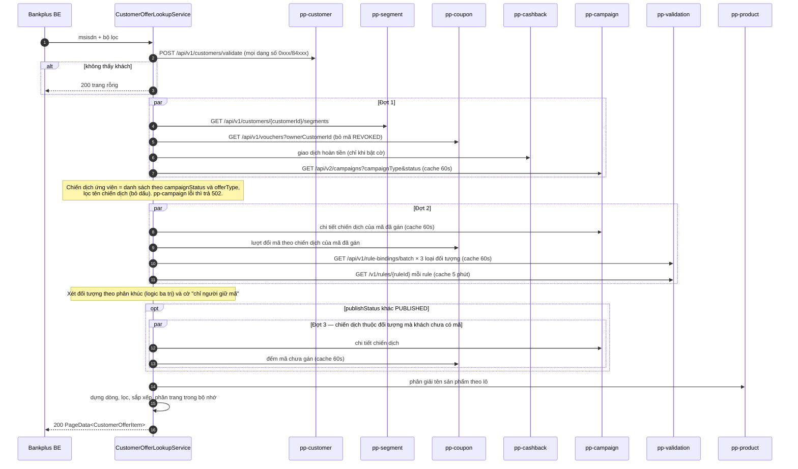
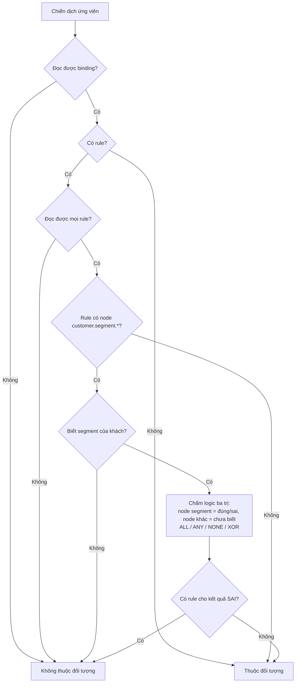
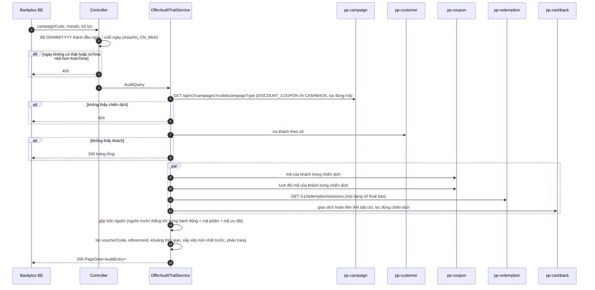
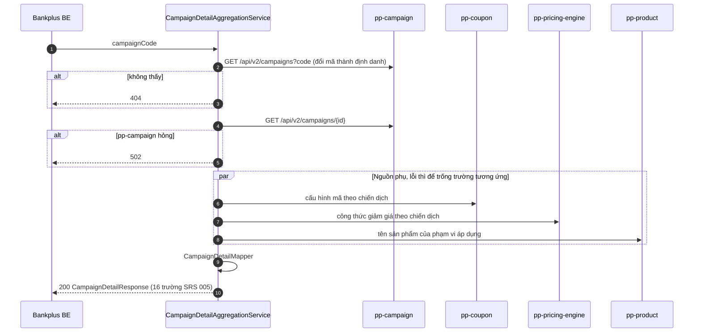
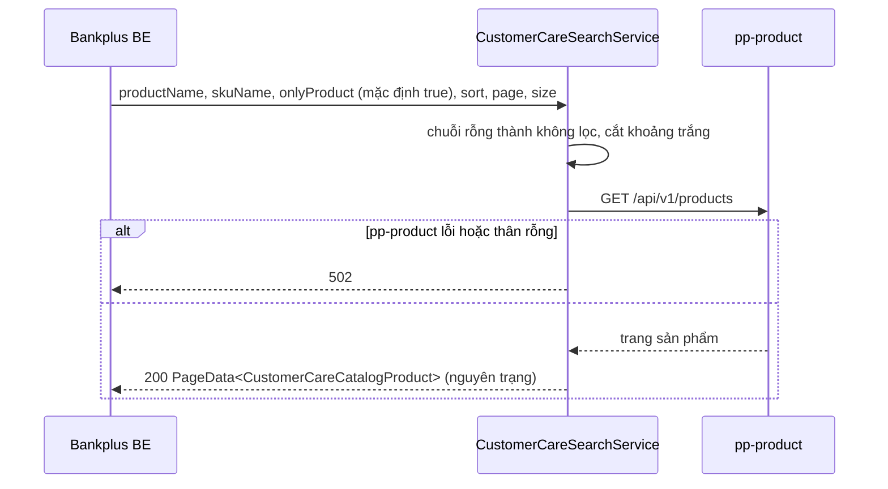

# Luồng các API trong `CustomerCareController`

Repo `promotion-vtm-bff`, nhánh `tamntt25/cskh-customer-care-api-rest`, commit `a47b8a2` (22/10/2026).
Tiền tố đường dẫn: `{context-path}/api/cskh/v1`. Người gọi: Bankplus BE. Xác thực nhân viên làm ngoài BFF.

| # | API | Đường dẫn | SRS | Bọc envelope |
|---|---|---|---|---|
| 1 | Đặc tả bộ lọc (dropdown) | `GET /api-specs` | 001 phụ lục 5.1 | Không |
| 2 | Tra cứu ưu đãi | `GET /customer-offers` | 003 | Có |
| 3 | Lịch sử tác động | `GET /customer-offers/audit` | 004 | Có |
| 4 | Chi tiết chiến dịch | `GET /campaign-details/{campaignCode}` | 005 | Có |
| 5 | Danh mục sản phẩm | `GET /products` | 001 mục 2.3 (dropdown sản phẩm) | Có |

Quy ước chung:

- Mọi giá trị dạng danh mục viết chữ hoa (`RUNNING`, `PUBLISHED`, `FAIL`…).
- Phân trang dùng `PageData`: trang bắt đầu từ 0, `size` từ 1 đến 100.
- Các lời gọi ra ngoài trong cùng một đợt chạy song song trên bể luồng `campaignDetailExecutor`. Tác vụ luôn được nộp từ luồng phục vụ request, không nộp lồng từ bên trong bể.
- Lỗi tham số trả 400 `INVALID_PARAMS`. Không thấy chiến dịch trả 404. Dịch vụ nguồn chính hỏng trả lỗi dịch vụ phụ thuộc (`DownstreamUnavailableException`).

---

## 1. `GET /api-specs` — đặc tả bộ lọc

Trả tài liệu OpenAPI rút gọn, chỉ còn thao tác `/customer-offers` và các schema nó dùng. Bankplus đọc `enum` và `x-enum-labels` của từng tham số lọc để dựng dropdown. Không gọi dịch vụ nào khác.

---

## 2. `GET /customer-offers` — tra cứu ưu đãi

**Tham số:**
- `msisdn` (bắt buộc), `voucherCode`, `campaignName`;
- `publishStatus` (`ALL` / `PUBLISHED` / `UNPUBLISHED` / `NOT_GENERATED`);
- `campaignStatus` (**mặc định `RUNNING`**);
- `useStatus`, `offerType`, `productCode`, `page`, `size`.

### 2.1 Xét đối tượng theo phân khúc

Đầu vào là binding còn hiệu lực của chiến dịch (loại `DISCOUNT_COUPON`, `CAMPAIGN`, `CASHBACK`), cây rule của từng binding, và segment của khách (gộp định danh với mã).

Cờ "chỉ người giữ mã" là có khi cây rule chứa node `redemption.code_holder.*` hoặc `customer.is_owner`.

### 2.2 Dựng dòng

| Nguồn | Điều kiện | `voucherCode` | `publishStatus` | `useStatus` |
|---|---|---|---|---|
| Mã đã gán | Chiến dịch là ứng viên và khách thuộc đối tượng | Mã của khách | `PUBLISHED`; mã đang `UNPUBLISHED` bên nguồn thì `UNPUBLISHED` | Từ giữ chỗ, lượt đổi gần nhất, bộ đếm |
| Hoàn tiền (khi bật cờ) | Như trên | null | null | `PARTICIPATED` |
| Giả lập: mã chung | Thuộc đối tượng, khách chưa có mã, không "chỉ người giữ mã" | Mã chung | `UNPUBLISHED` | `UNUSED` |
| Giả lập: còn mã | Như trên, còn mã chưa gán > 0 | null (hiển thị "Còn mã") | `UNPUBLISHED` | `UNUSED` |
| Giả lập: tự sinh | Như trên, hết mã nhưng chiến dịch tự sinh mã | null (hiển thị "-") | `NOT_GENERATED` | `UNUSED` |
| Không có dòng | Không tra được chi tiết chiến dịch, không đếm được tồn kho, hoặc hết mã mà không tự sinh | | | |

Bản ghi giả lập chỉ được dựng khi `publishStatus` là `ALL`, `UNPUBLISHED` hoặc `NOT_GENERATED`. Khi lọc `PUBLISHED`, bước xét đối tượng chỉ chạy cho chiến dịch của mã đã gán, và không đếm tồn kho.

### 2.3 Lọc, sắp xếp, phân trang

- **Lọc trong bộ nhớ:**
  - `voucherCode`: chứa chuỗi, không phân biệt hoa thường.
  - `campaignName`: chứa chuỗi, bỏ dấu.
  - `publishStatus`, `campaignStatus`, `useStatus`, `offerType`: so khớp chính xác.
  - `productCode`: khớp mã SKU hoặc mã sản phẩm trong phạm vi áp dụng, có xét phần bị loại trừ.
- **Sắp xếp (SRS 2.3):** ngày bắt đầu giảm dần → ngày gán giảm dần → ngày dùng giảm dần → mã chiến dịch tăng dần → mã ưu đãi.

---

## 3. `GET /customer-offers/audit` — lịch sử tác động

**Tham số:**
- `campaignCode`, `msisdn` (cả hai bắt buộc);
- `voucherCode`, `referenceId`;
- `fromTime` / `toTime` dạng `DD/MM/YYYY`, tính trọn ngày theo giờ Việt Nam;
- `page`, `size`.

**Hành động sinh ra từ mỗi nguồn:**

| Nguồn | Hành động |
|---|---|
| Phiên đổi thưởng (pp-redemption) | `SESSION_CREATED`, `SESSION_CONFIRMED` (`result` là `SUCCESS` hoặc `FAIL`), `SESSION_CANCELLED`, `REDEMPTION_ROLLED_BACK` |
| Lượt đổi mã (pp-coupon) | `SESSION_CONFIRMED`, `REDEMPTION_ROLLED_BACK` |
| Mã đã gán (pp-coupon) | `VOUCHER_ASSIGNED` |
| Giao dịch hoàn tiền (pp-cashback) | `TRANSACTION_QUALIFIED`, `TRANSACTION_CONFIRMED`, `CASHBACK_CREATED` |

Nguồn phụ lỗi chỉ làm thiếu nhóm dòng của nguồn đó. API này không lọc theo phân khúc.

---

## 4. `GET /campaign-details/{campaignCode}` — chi tiết chiến dịch

**Nguồn của từng trường:**

| Trường | Nguồn |
|---|---|
| `campaignCode`, `campaignName`, `campaignStatus`, `periodFrom`, `periodTo` | pp-campaign |
| `periodTimeLimit` | Tổng hợp từ khung giờ và ngày trong tuần của pp-campaign (phụ lục 5.2) |
| `campaignType` | Loại mã của pp-coupon (dự phòng: pp-campaign). `BULK_CODE` thành `BATCH_CODE`, `SINGLE_CODE` thành `COMMON_CODE`. Hoàn tiền trả null |
| `discountType` | Nhóm giảm giá của pp-pricing-engine (dự phòng: bản chụp ở pp-campaign). `ORDER` thành `TRANSACTION_DISCOUNT`, `PRODUCT` thành `PRODUCT_DISCOUNT`, `FREE_SHIPPING` thành `NO_TRANSACTION_FEE` |
| `discountMethod` | `AMOUNT` giữ nguyên, `PERCENT` thành `PERCENTAGE`. Null khi `NO_TRANSACTION_FEE` |
| `percentageOff`, `amountOff` | pp-pricing-engine (dự phòng: pp-campaign) |
| `applicableProducts` | Phạm vi áp dụng ở pp-campaign, tên lấy từ pp-product, bỏ phần bị loại trừ |
| `voucherName`, `brandName`, `detailInfo` | pp-coupon (dự phòng: bản chụp hiển thị ở pp-campaign) |
| `usageGuideUrl` | Như trên, đổi khoá ảnh thành đường dẫn xem ảnh |

---

## 5. `GET /products` — danh mục sản phẩm

Chuyển tiếp sang `GET /api/v1/products` của pp-product, dùng làm nguồn cho dropdown "Sản phẩm áp dụng".

- `sort` chỉ nhận cột `name`, `createdAt`, `updatedAt` (dạng `cột,hướng`).
- Để lọc ưu đãi theo chiến dịch giới hạn sản phẩm, lấy `productCode` của kết quả. Với chiến dịch giới hạn theo SKU thì gọi `onlyProduct=false` và lấy `skuCode`.

---

## 6. Cache trong tiến trình

| Dữ liệu | Thời gian sống | Ghi chú |
|---|---|---|
| Danh sách chiến dịch theo loại và trạng thái | 60 giây | Tối đa 20 trang × 100 chiến dịch cho mỗi loại |
| Chi tiết chiến dịch | 60 giây | Không cache kết quả rỗng |
| Binding rule theo chiến dịch | 60 giây | Không cache lỗi |
| Cây rule | 5 phút | Không cache lỗi |
| Số mã chưa gán | 60 giây | Không cache lỗi |
